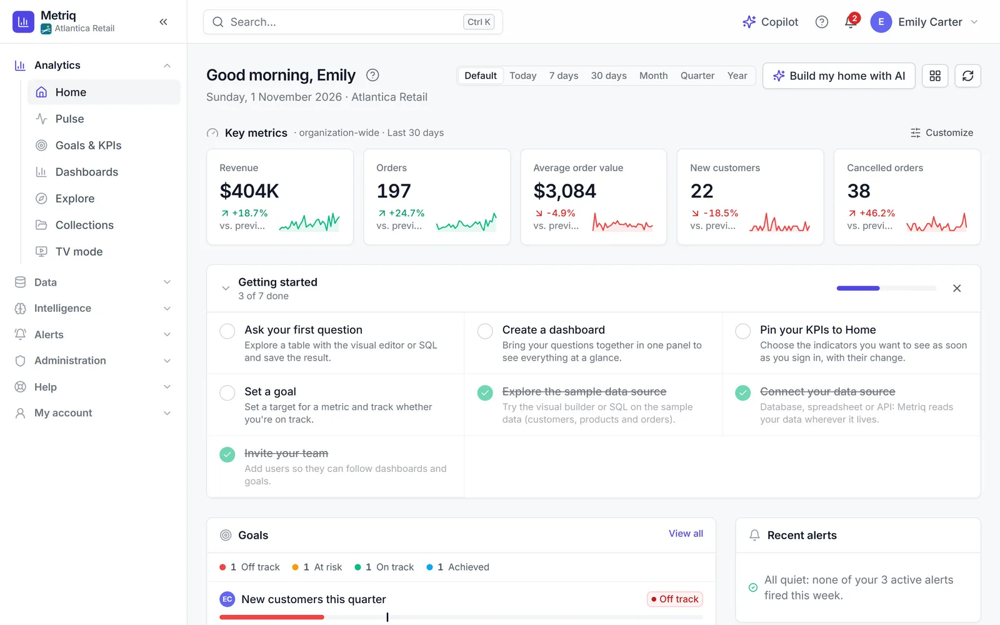
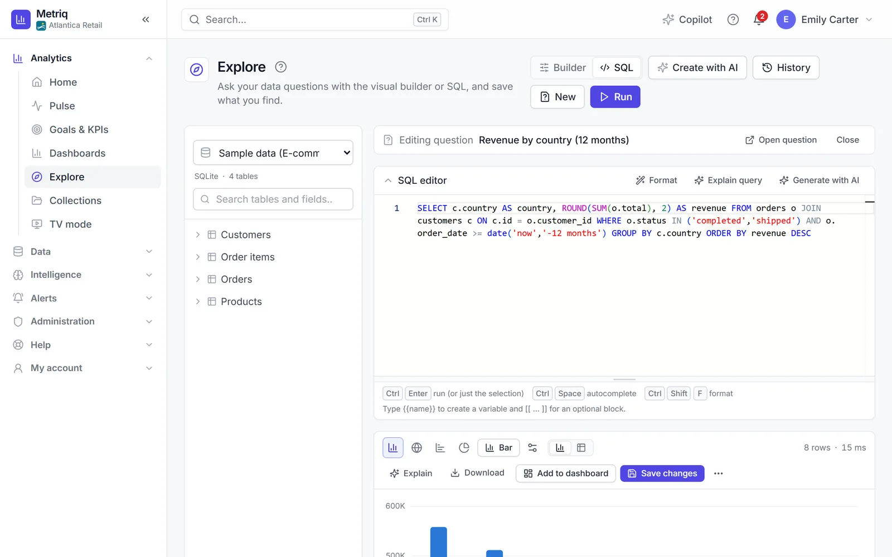
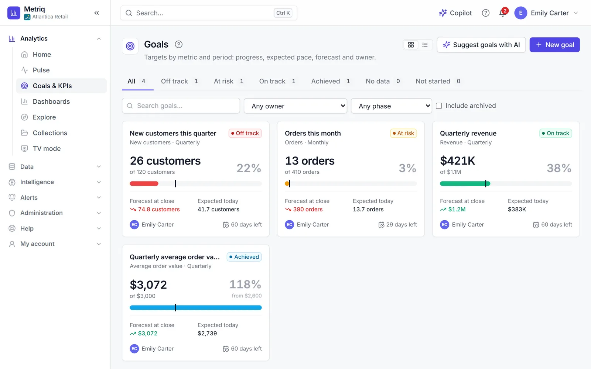
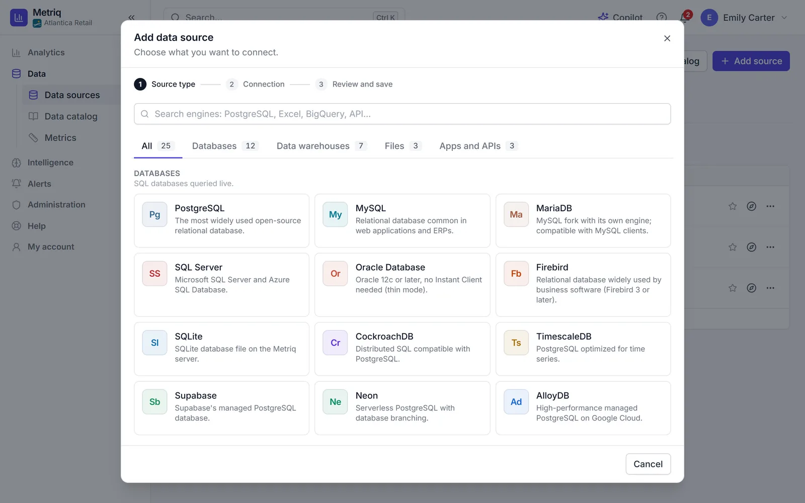
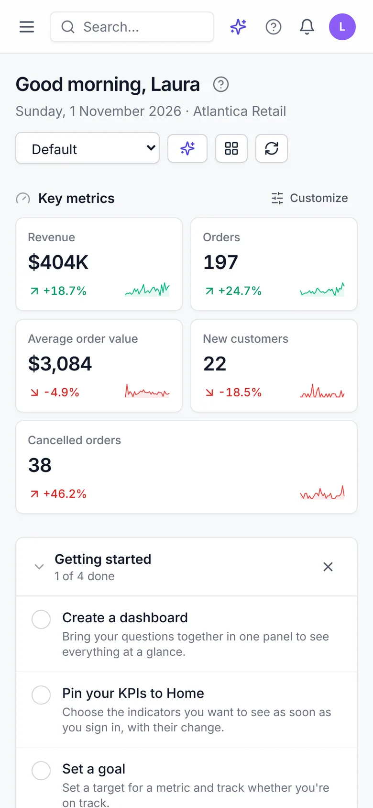

<div align="center">


# Metriq

**Self-service business intelligence that installs on your own server, no cloud**

[](https://github.com/Rannden-SHA/Metriq-Releases/releases/latest) [](https://github.com/Rannden-SHA/Metriq-Releases/releases) [](#requirements) [](README.md)

**[Download the latest version](https://github.com/Rannden-SHA/Metriq-Releases/releases/latest)** · [User manual (PDF)](https://github.com/Rannden-SHA/Metriq-Releases/releases/latest/download/Metriq-Manual-en.pdf) · [Metriq website](https://nextcodeagency.com/proyectos/metriq)

[Español](README.md) · **English**

<br>


</div>

<br>

**Metriq** is a self-service business intelligence (BI) platform that installs **on your own
server, Windows or Linux**. Connect your databases, warehouses, files and apps; explore with SQL or a
visual builder; build interactive dashboards and give leadership an **executive view** with KPIs and
goals that make sense at a glance. It includes an **AI assistant** (Claude, OpenAI or a local Ollama)
that answers questions about your data and builds queries and dashboards.

**No cloud**: Metriq runs on your server and your data never leaves it. There are no accounts on
outside services and no per-user pricing. The whole interface is available in **English and
Spanish**, with help on every screen.

> [!NOTE]
> This repository only holds the **installation packages**, the **user manual** and the **release
> notes**. **Metriq's source code is not here** and is not published.

### User manual

All of Metriq step by step, with real screenshots: installation and licensing, data sources,
exploring with SQL and the visual builder, dashboards, metrics, goals, alerts, AI, administration,
server operations, troubleshooting and FAQ. Since 2.1.1 you can also open it from Metriq's **Help
center**, in each user's language.

- [Manual in English (PDF)](https://github.com/Rannden-SHA/Metriq-Releases/releases/latest/download/Metriq-Manual-en.pdf)
- [Manual en español (PDF)](https://github.com/Rannden-SHA/Metriq-Releases/releases/latest/download/Metriq-Manual-es.pdf)

## Highlights

#### Data sources
- **25 data source types** in four families: databases (PostgreSQL, MySQL, MariaDB, SQL Server,
  Oracle, SQLite, Firebird…), warehouses (Redshift, ClickHouse, Trino, Athena, BigQuery, Snowflake),
  files (CSV, Excel, Parquet, JSON, Microsoft 365) and apps (Google Sheets, REST API, MongoDB)
- SSH tunnel to reach databases behind a bastion host
- Data catalog and business glossary

#### Explore and visualize
- SQL editor with autocomplete **or** a visual builder with no SQL at all
- 29 visualization types and dashboards with tabs, cross-filtering, comparisons and annotations
- Export to PDF, Excel, PNG and CSV; public links and embedding

#### Executive view
- Home page with KPIs, goals and "what changed"
- Goals & KPIs with progress, forecast at close and status
- Daily or weekly summary, and TV mode for office screens

#### Built-in AI
- Chat with your data, text-to-SQL and complete AI-built dashboards
- Copilot (`Ctrl+J`) that creates questions, dashboards, goals and alerts from a single request
- Claude, OpenAI or a **local Ollama**, with usage limits per organization, group and user

#### Security and administration
- Users, groups, roles and a permission matrix; row-level security
- Two-step verification, revocable sessions, SSO with Google and Microsoft
- Encrypted credentials, read-only SQL and an audit log
- Threshold and anomaly alerts, plus scheduled PDF reports by email

## What's new in 2.1.1

- **You no longer need to install Python**: the Windows and Linux installers ship their own
  (CPython 3.12.15).
- When you upgrade from 2.0 or 2.1.0, the wizard rebuilds the Python environment with the bundled
  Python. Data, license and configuration are kept, and if anything fails the previous installation
  is restored.
- The Debian package is now named `metriq_2.1.1_amd64.deb` and upgrades an installation made with
  `metriq_2.1.0_all.deb` in place.
- **User manual in PDF**, in English and Spanish, available from the Help center, the sidebar and
  the website.
- Downloads now come from this repository, and the **one-line Linux install** checks the SHA-256 hash
  of what it downloads and opens the interactive wizard in the terminal again.
- Self-extracting installer, `install.sh`, Start menu shortcuts and the backup task follow the
  installation language; on Windows, Metriq no longer appears twice in Installed apps.
- API dates are always in UTC with a time zone; public links use the organization's currency, number
  format and time zone; row-level security only blocks native SQL for users a policy applies to.

The full list is in the [2.1.1 release notes](https://github.com/Rannden-SHA/Metriq-Releases/releases/tag/v2.1.1).

## Screenshots


<p align="center"><sub><b>Home</b>: key metrics, getting started, goals and recent alerts</sub></p>


<p align="center"><sub><b>Sales dashboard</b> with tabs, previous-period comparison and annotations</sub></p>


<p align="center"><sub><b>AI assistant</b>: a plain-language question, with the query already run and its chart</sub></p>

<details>
<summary><b>More screenshots</b></summary>
<br>


<p align="center"><sub><b>Explore in SQL mode</b>: editor with autocomplete and the result as a chart</sub></p>


<p align="center"><sub><b>Goals & KPIs</b>: progress, forecast at close and status</sub></p>


<p align="center"><sub><b>Add a data source</b>: engine gallery with search</sub></p>

<p align="center"></p>
<p align="center"><sub><b>On a phone</b>: the home page</sub></p>

</details>

<sub>Screenshots use demo data from a fictitious company.</sub>

## Downloads

Everything is on the [releases page](https://github.com/Rannden-SHA/Metriq-Releases/releases). The
packages carry the version number in their names; download them from *Assets* in the
[latest release](https://github.com/Rannden-SHA/Metriq-Releases/releases/latest).

| File | What it's for |
|---|---|
| `MetriqSetup-<version>.exe` | Installer for **Windows** 10/11 and Windows Server 2016 or later (64-bit). |
| `metriq-installer-<version>.run` | Self-extracting installer for **Linux** (any distribution). The recommended option on Linux. |
| `metriq-installer-<version>.run.sha256` | SHA-256 hash of the `.run`, for `install.sh` and for checking it by hand. |
| `metriq_<version>_amd64.deb` | Package for **Debian and Ubuntu** (amd64). |
| `metriq-<version>.tar.gz` | Package for a manual install, or to review the contents before installing. |
| [`install.sh`](https://github.com/Rannden-SHA/Metriq-Releases/releases/latest/download/install.sh) | One-line Linux install: downloads and verifies the latest version and opens the wizard. |
| [`SHA256SUMS.txt`](https://github.com/Rannden-SHA/Metriq-Releases/releases/latest/download/SHA256SUMS.txt) | SHA-256 hashes of every file in the release. |
| [`Metriq-Manual-en.pdf`](https://github.com/Rannden-SHA/Metriq-Releases/releases/latest/download/Metriq-Manual-en.pdf) | User manual in English. |
| [`Metriq-Manual-es.pdf`](https://github.com/Rannden-SHA/Metriq-Releases/releases/latest/download/Metriq-Manual-es.pdf) | User manual in Spanish. |

The linked files always point to the latest published version.

## Requirements

| Requirement | Windows | Linux |
|---|---|---|
| **Operating system** | Windows 10 (1607) / Windows Server 2016 or later, **64-bit** | Debian 11+, Ubuntu 20.04+, RHEL / Rocky / AlmaLinux 8+, openSUSE or Arch, with **systemd** |
| **Architecture** | x64 | x86-64 (amd64). On arm64, only the `.run` or `.tar.gz`, with system Python 3.11+ and access to PyPI |
| **Python** | **Not needed**: the installer ships its own Python 3.12 | **Not needed** on x86-64: the package ships its own Python 3.12 |
| **Free disk space** | 2 GB for the program · 1 GB for data | 2 GB in `/opt` · 1 GB in `/var/lib` |
| **Permissions** | Local administrator | `root` (via `sudo`) |
| **Port** | One free port (**8000** by default) | One free port (**8000** by default) |
| **Metriq database** | Built-in SQLite (nothing else needed) or PostgreSQL | Built-in SQLite (nothing else needed) or PostgreSQL |
| **Browsers** | Any current browser (Edge, Chrome, Firefox, Safari) | Same |

Metriq's own database stores users, dashboards and permissions; it is not the database you'll
analyze. SQLite is fine for up to about 25 people, trials and pilots; use PostgreSQL in production.

**No Internet access is needed** to install or use Metriq: the packages include their dependencies.
You only need it for the one-line install, for AI with Claude or OpenAI (Ollama runs locally) and for
data sources that live in the cloud.

## Installation

### Windows

1. Download `MetriqSetup-<version>.exe` from *Assets* in the
   [latest release](https://github.com/Rannden-SHA/Metriq-Releases/releases/latest) and
   [check its hash](#verify-your-download).
2. Run it **as administrator**. The installer copies the files and opens the **setup wizard**:
   database, administrator account, network and access, HTTPS, license, AI, outgoing email, Windows
   service and backups. Nothing is changed until the final summary.
3. Open the address shown on the last screen (for example `http://192.168.1.20:8000`) and sign in
   with the administrator's email and password.

> [!TIP]
> The installer is not code-signed: Windows SmartScreen may show "Windows protected your PC". Check
> the SHA-256 hash, then click **"More info" → "Run anyway"**.

Unattended install with an answers file:

```powershell
$env:METRIQ_ADMIN_PASSWORD = 'A-long-unique-password'
.\MetriqSetup-<version>.exe /VERYSILENT /SUPPRESSMSGBOXES /ANSWERS="C:\metriq\answers.json"
```

### Linux in one line

On a server with Internet access:

```bash
curl -fsSL https://github.com/Rannden-SHA/Metriq-Releases/releases/latest/download/install.sh | sudo sh
```

The script detects the distribution, downloads the latest `.run`, **verifies its SHA-256 hash** and
opens the wizard in the terminal. For the wizard and messages in English:

```bash
curl -fsSL https://github.com/Rannden-SHA/Metriq-Releases/releases/latest/download/install.sh | sudo sh -s -- --lang en
```

### Linux with a package

| Package | Command |
|---|---|
| `.run` (any distribution) | `chmod +x metriq-installer-<version>.run && sudo ./metriq-installer-<version>.run` |
| `.deb` (Debian and Ubuntu) | `sudo apt install ./metriq_<version>_amd64.deb`, then `sudo metriq-setup` |
| `.tar.gz` | `tar xzf metriq-<version>.tar.gz`, go into the folder and run `sudo ./install.sh` |

The wizard works over SSH with no desktop environment and takes care of the systemd service, the
firewall, the certificate (self-signed, your own, or Let's Encrypt with nginx or Caddy) and backups.
If an essential step fails, it rolls back what it did.

## Upgrading

Data, configuration, keys and license are kept.

- **Windows**: run the new `MetriqSetup-<version>.exe` as administrator and choose **Update to version …**. Before
  changing anything it saves a copy of the previous installation in the backups folder.
- **Linux**: `sudo ./metriq-installer-<new version>.run --upgrade`, or
  `sudo apt install ./metriq_<new version>_amd64.deb` followed by `sudo metriq-setup --upgrade`.

From 2.0 or 2.1.0 (which used the system Python), the wizard rebuilds the environment with the
bundled Python. You can then uninstall that Python if nothing else uses it.

## Verify your download

Every release publishes `SHA256SUMS.txt` with the SHA-256 hash of all its files. Download it next to
the packages and compare. If they don't match, don't install: download the file again.

**Windows** (PowerShell, in the download folder):

```powershell
Get-FileHash .\MetriqSetup-<version>.exe -Algorithm SHA256
# or compare it with SHA256SUMS.txt directly (prints True when it matches):
$file = 'MetriqSetup-<version>.exe'
$expected = ((Select-String -Path .\SHA256SUMS.txt -Pattern ([regex]::Escape(" $file") + '$')).Line -split '\s+')[0]
(Get-FileHash ".\$file" -Algorithm SHA256).Hash -eq $expected
```

**Linux** (in the download folder):

```bash
sha256sum -c --ignore-missing SHA256SUMS.txt
```

The `.run` also carries the hash of its contents and checks it on start
(`./metriq-installer-<version>.run --sfx-check` verifies it without installing anything), and
`install.sh` always checks the hash before running what it downloads.

## License

Metriq is **proprietary software** owned by NextCode Agency (© 2026 NextCode Agency. All rights
reserved). It is neither free software nor open source: this repository only publishes the
installation packages, the manual and the release notes.

Use of Metriq is governed by the **Metriq End User License Agreement** (in Spanish and English; the
Spanish version prevails), which is **shown and accepted during installation** and can be read in the
`LICENSE` file included in every package. Summary in [`LICENSE.md`](LICENSE.md).

- **It installs and runs without a license file**, with no expiry, using the **core features**: SQL editor
  and visual builder, dashboards, 23 of the 25 data source types, file uploads, users, groups and
  permissions, 2FA, system service and automatic backups.
- The **modules** (AI assistant, alerts and reports, public links and embedding, SSO, row-level
  security, templates, the metrics layer and the BigQuery and Snowflake connectors) are unlocked by a
  **signed license** (`.metriqlic`), issued for each installation and checked locally, with no
  Internet access. There is no per-user pricing.
- To request, renew or extend a license, send your **instance code** (`MTRQ-…`, shown in
  *Administration › License* or by `metriqctl instance-id`) to
  [info@nextcodeagency.com](mailto:info@nextcodeagency.com).

More information, plans and contact: [nextcodeagency.com/proyectos/metriq](https://nextcodeagency.com/proyectos/metriq).

<p align="right"><a href="#metriq">↑ Back to top</a></p>
