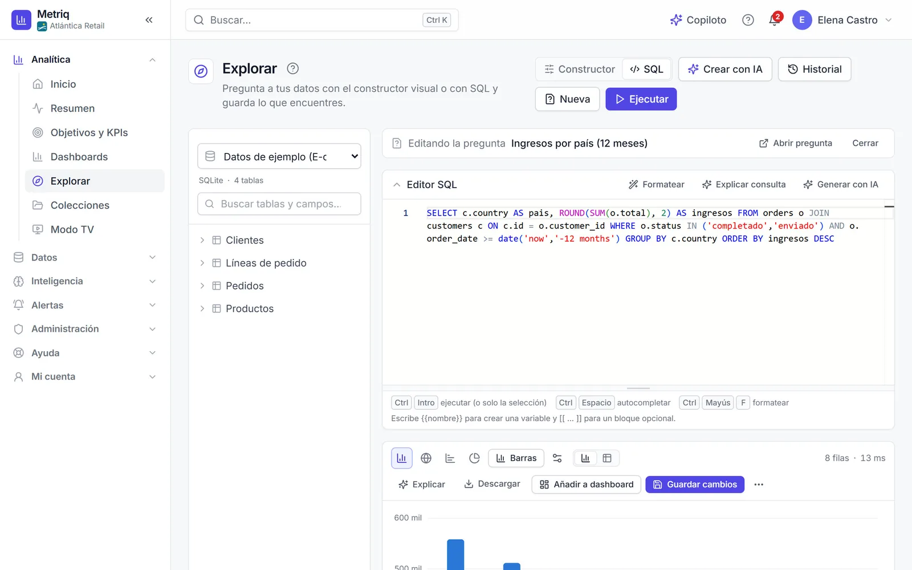
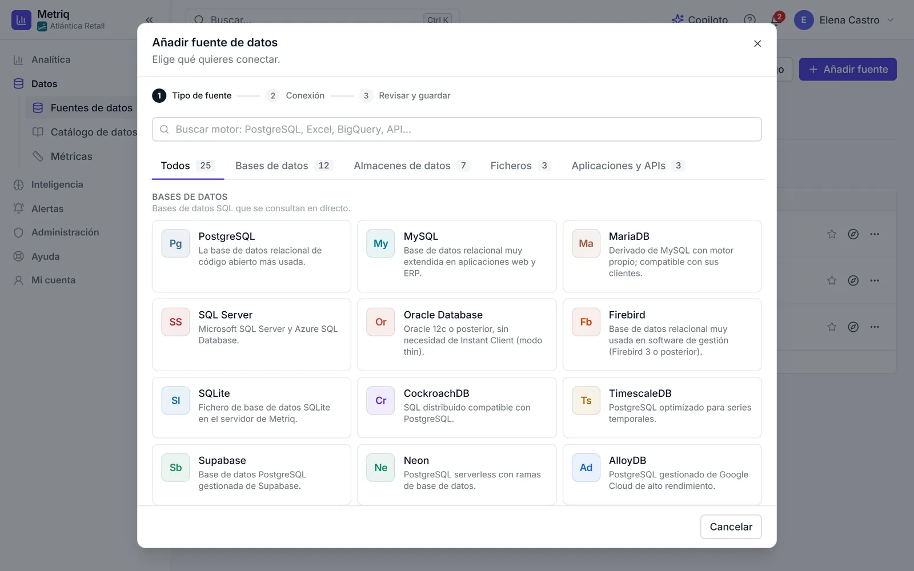
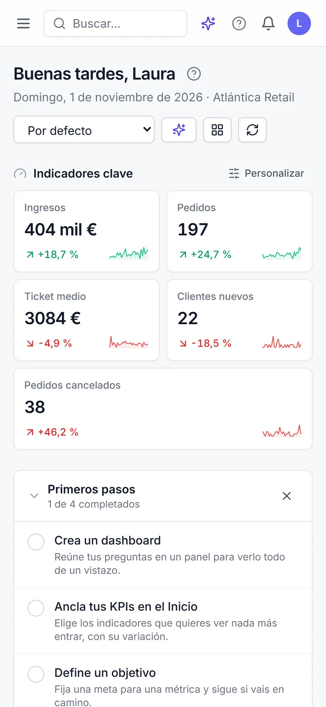

<div align="center">


# Metriq

**Business Intelligence self-service que se instala en tu servidor, sin nube**

[](https://github.com/Rannden-SHA/Metriq-Releases/releases/latest) [](https://github.com/Rannden-SHA/Metriq-Releases/releases) [](#requisitos) [](README.en.md)

**[Descargar la última versión](https://github.com/Rannden-SHA/Metriq-Releases/releases/latest)** · [Manual de usuario (PDF)](https://github.com/Rannden-SHA/Metriq-Releases/releases/latest/download/Metriq-Manual-es.pdf) · [Web de Metriq](https://nextcodeagency.com/proyectos/metriq)

**Español** · [English](README.en.md)

<br>


</div>

<br>

**Metriq** es una plataforma de análisis de datos (BI) *self-service* que se instala **en tu propio
servidor, Windows o Linux**. Conecta tus bases de datos, almacenes, ficheros y aplicaciones; explora
con SQL o con un constructor visual; monta dashboards interactivos y da a la dirección una **vista
ejecutiva** con KPIs y objetivos que se entienden de un vistazo. Incluye un **asistente de IA**
(Claude, OpenAI u Ollama en local) que responde preguntas sobre tus datos y crea consultas y
dashboards.

**Sin nube**: Metriq se ejecuta en tu servidor y tus datos no salen de él. No hay cuentas en
servicios externos ni pago por usuario. Toda la interfaz está en **español e inglés**, con ayuda en
cada pantalla.

> [!NOTE]
> Este repositorio solo contiene los **paquetes de instalación**, el **manual de usuario** y las
> **notas de cada versión**. **El código fuente de Metriq no está aquí** y no se publica.

### Manual de usuario

Todo Metriq paso a paso, con capturas reales: instalación y licencia, fuentes de datos, explorar con
SQL y con el constructor visual, dashboards, métricas, objetivos, alertas, IA, administración,
operación del servidor, solución de problemas y preguntas frecuentes. Desde la 2.1.1 también se abre
desde el **Centro de ayuda** de Metriq, en el idioma de cada usuario.

- [Manual en español (PDF)](https://github.com/Rannden-SHA/Metriq-Releases/releases/latest/download/Metriq-Manual-es.pdf)
- [Manual in English (PDF)](https://github.com/Rannden-SHA/Metriq-Releases/releases/latest/download/Metriq-Manual-en.pdf)

## Lo más destacado

#### Fuentes de datos
- **25 tipos de fuente** en cuatro familias: bases de datos (PostgreSQL, MySQL, MariaDB, SQL Server,
  Oracle, SQLite, Firebird…), almacenes (Redshift, ClickHouse, Trino, Athena, BigQuery, Snowflake),
  ficheros (CSV, Excel, Parquet, JSON, Microsoft 365) y aplicaciones (Google Sheets, API REST,
  MongoDB)
- Túnel SSH para llegar a bases de datos detrás de un bastión
- Catálogo de datos y glosario de negocio

#### Explorar y visualizar
- Editor SQL con autocompletado **o** constructor visual sin escribir SQL
- 29 tipos de visualización y dashboards con pestañas, filtros cruzados, comparativas y anotaciones
- Exportación a PDF, Excel, PNG y CSV; enlaces públicos y *embedding*

#### Vista ejecutiva
- Inicio con KPIs, objetivos y «qué ha cambiado»
- Objetivos y KPIs con progreso, previsión al cierre y estado
- Resumen diario o semanal, modo TV para pantallas de la oficina

#### IA integrada
- Chat sobre tus datos, *text-to-SQL* y generación de dashboards completos
- Copiloto (`Ctrl+J`) que crea preguntas, dashboards, objetivos y alertas a partir de una petición
- Claude, OpenAI u **Ollama en local**, con límites de consumo por organización, grupo y usuario

#### Seguridad y administración
- Usuarios, grupos, roles y matriz de permisos; seguridad a nivel de fila
- Verificación en dos pasos, sesiones revocables, SSO con Google y Microsoft
- Credenciales cifradas, SQL de solo lectura y registro de auditoría
- Alertas por umbral y por anomalía, e informes PDF programados por correo

## Novedades de la 2.1.1

- **Ya no hace falta instalar Python**: los instaladores de Windows y Linux traen el suyo
  (CPython 3.12.15).
- Al actualizar desde la 2.0 o la 2.1.0, el asistente rehace el entorno de Python con el Python
  incluido. Los datos, la licencia y la configuración no se tocan, y si algo falla se vuelve a la
  instalación anterior.
- El paquete Debian pasa a llamarse `metriq_2.1.1_amd64.deb` y actualiza sin más una instalación
  hecha con `metriq_2.1.0_all.deb`.
- **Manual de usuario en PDF**, en español y en inglés, accesible desde el Centro de ayuda, el menú
  lateral y la web.
- Las descargas pasan a este repositorio, y la **instalación en una línea** en Linux comprueba la
  huella SHA-256 de lo que descarga y vuelve a abrir el asistente interactivo en la terminal.
- Instalador autoextraíble, `install.sh`, accesos del menú Inicio y tarea de copias en el idioma de
  la instalación; en Windows, Metriq ya no aparece dos veces en «Aplicaciones instaladas».
- Fechas de la API siempre en UTC con zona; los enlaces públicos usan la moneda, el formato y la
  zona horaria de la organización; la seguridad de filas solo bloquea el SQL nativo a quien le
  afecta alguna política.

La lista completa está en las [notas de la versión 2.1.1](https://github.com/Rannden-SHA/Metriq-Releases/releases/tag/v2.1.1).

## Capturas


<p align="center"><sub><b>Inicio</b>: indicadores clave, primeros pasos, objetivos y alertas recientes</sub></p>


<p align="center"><sub><b>Dashboard de ventas</b> con pestañas, comparativa con el periodo anterior y anotaciones</sub></p>


<p align="center"><sub><b>Asistente de IA</b>: una pregunta en lenguaje natural, con la consulta ya ejecutada y su gráfico</sub></p>

<details>
<summary><b>Más capturas</b></summary>
<br>


<p align="center"><sub><b>Explorar en modo SQL</b>: editor con autocompletado y resultado en gráfico</sub></p>


<p align="center"><sub><b>Objetivos y KPIs</b>: avance, previsión al cierre y estado</sub></p>


<p align="center"><sub><b>Añadir una fuente de datos</b>: galería de motores con buscador</sub></p>

<p align="center"></p>
<p align="center"><sub><b>En el móvil</b>: la página de inicio</sub></p>

</details>

<sub>Capturas con datos de demostración de una empresa ficticia.</sub>

## Descargas

Todo está en la [página de versiones](https://github.com/Rannden-SHA/Metriq-Releases/releases). Los
paquetes llevan el número de versión en el nombre; descárgalos desde *Assets* en la
[última versión](https://github.com/Rannden-SHA/Metriq-Releases/releases/latest).

| Fichero | Para qué |
|---|---|
| `MetriqSetup-<versión>.exe` | Instalador para **Windows** 10/11 y Windows Server 2016 o posterior (64 bits). |
| `metriq-installer-<versión>.run` | Instalador autoextraíble para **Linux** (cualquier distribución). Opción recomendada en Linux. |
| `metriq-installer-<versión>.run.sha256` | Huella SHA-256 del `.run`, para `install.sh` y para comprobarlo a mano. |
| `metriq_<versión>_amd64.deb` | Paquete para **Debian y Ubuntu** (amd64). |
| `metriq-<versión>.tar.gz` | Paquete para instalación manual o para revisar el contenido antes de instalar. |
| [`install.sh`](https://github.com/Rannden-SHA/Metriq-Releases/releases/latest/download/install.sh) | Instalación en una línea en Linux: descarga y verifica la última versión y abre el asistente. |
| [`SHA256SUMS.txt`](https://github.com/Rannden-SHA/Metriq-Releases/releases/latest/download/SHA256SUMS.txt) | Huellas SHA-256 de todos los ficheros de la versión. |
| [`Metriq-Manual-es.pdf`](https://github.com/Rannden-SHA/Metriq-Releases/releases/latest/download/Metriq-Manual-es.pdf) | Manual de usuario en español. |
| [`Metriq-Manual-en.pdf`](https://github.com/Rannden-SHA/Metriq-Releases/releases/latest/download/Metriq-Manual-en.pdf) | Manual de usuario en inglés. |

Los ficheros enlazados apuntan siempre a la última versión publicada.

## Requisitos

| Requisito | Windows | Linux |
|---|---|---|
| **Sistema operativo** | Windows 10 (1607) / Windows Server 2016 o posterior, **64 bits** | Debian 11+, Ubuntu 20.04+, RHEL / Rocky / AlmaLinux 8+, openSUSE o Arch, con **systemd** |
| **Arquitectura** | x64 | x86-64 (amd64). En arm64, solo el `.run` o el `.tar.gz`, con Python 3.11+ del sistema y acceso a PyPI |
| **Python** | **No hace falta**: el instalador lleva su propio Python 3.12 | **No hace falta** en x86-64: el paquete lleva su propio Python 3.12 |
| **Espacio libre** | 2 GB para el programa · 1 GB para los datos | 2 GB en `/opt` · 1 GB en `/var/lib` |
| **Permisos** | Administrador local | `root` (con `sudo`) |
| **Puerto** | Uno libre (**8000** por omisión) | Uno libre (**8000** por omisión) |
| **Base de datos de Metriq** | SQLite integrada (sin nada más) o PostgreSQL | SQLite integrada (sin nada más) o PostgreSQL |
| **Navegadores** | Cualquier navegador actual (Edge, Chrome, Firefox, Safari) | Igual |

La base de datos de Metriq guarda usuarios, dashboards y permisos; no es la que vas a analizar.
SQLite sirve hasta unas 25 personas, pruebas y pilotos; para producción, PostgreSQL.

**Internet no es necesario** para instalar ni para usar Metriq: los paquetes llevan las dependencias.
Solo hace falta para la instalación en una línea, para la IA con Claude u OpenAI (Ollama funciona en
local) y para las fuentes de datos que estén en la nube.

## Instalación

### Windows

1. Descarga `MetriqSetup-<versión>.exe` desde *Assets* en la
   [última versión](https://github.com/Rannden-SHA/Metriq-Releases/releases/latest) y
   [comprueba su huella](#verificar-la-descarga).
2. Ejecútalo **como administrador**. El instalador copia los archivos y abre el **asistente de
   configuración**: base de datos, cuenta de administrador, red y acceso, HTTPS, licencia, IA,
   correo saliente, servicio de Windows y copias de seguridad. Hasta el resumen final no se modifica
   nada.
3. Abre la dirección que muestra la pantalla final (por ejemplo `http://192.168.1.20:8000`) y entra
   con el correo y la contraseña del administrador.

> [!TIP]
> El instalador no está firmado digitalmente: Windows SmartScreen puede mostrar «Windows protegió su
> PC». Comprueba la huella SHA-256 y pulsa **«Más información» → «Ejecutar de todas formas»**.

Instalación desatendida con un fichero de respuestas:

```powershell
$env:METRIQ_ADMIN_PASSWORD = 'Contrasena-larga-y-unica'
.\MetriqSetup-<versión>.exe /VERYSILENT /SUPPRESSMSGBOXES /ANSWERS="C:\metriq\answers.json"
```

### Linux en una línea

En un servidor con salida a internet:

```bash
curl -fsSL https://github.com/Rannden-SHA/Metriq-Releases/releases/latest/download/install.sh | sudo sh
```

El guion detecta la distribución, descarga el `.run` de la última versión, **verifica su huella
SHA-256** y abre el asistente en la terminal. Para el asistente y los mensajes en inglés:

```bash
curl -fsSL https://github.com/Rannden-SHA/Metriq-Releases/releases/latest/download/install.sh | sudo sh -s -- --lang en
```

### Linux con un paquete

| Paquete | Orden |
|---|---|
| `.run` (cualquier distribución) | `chmod +x metriq-installer-<versión>.run && sudo ./metriq-installer-<versión>.run` |
| `.deb` (Debian y Ubuntu) | `sudo apt install ./metriq_<versión>_amd64.deb` y después `sudo metriq-setup` |
| `.tar.gz` | `tar xzf metriq-<versión>.tar.gz`, entra en la carpeta y `sudo ./install.sh` |

El asistente funciona por SSH, sin entorno gráfico, y se encarga del servicio systemd, el
cortafuegos, el certificado (autofirmado, propio o Let's Encrypt con nginx o Caddy) y las copias de
seguridad. Si falla un paso esencial, deshace lo hecho.

## Actualizar

Los datos, la configuración, las claves y la licencia se conservan.

- **Windows**: ejecuta el `MetriqSetup-<versión nueva>.exe` como administrador y elige
  **Actualizar a la versión …**. Antes de tocar nada guarda una copia de la instalación anterior en la carpeta de
  copias.
- **Linux**: `sudo ./metriq-installer-<versión nueva>.run --upgrade`, o
  `sudo apt install ./metriq_<versión nueva>_amd64.deb` y `sudo metriq-setup --upgrade`.

Desde la 2.0 o la 2.1.0 (que usaban el Python del sistema), el asistente rehace el entorno con el
Python incluido. Después puedes desinstalar ese Python si no lo usa nada más.

## Verificar la descarga

Cada versión publica `SHA256SUMS.txt` con la huella SHA-256 de todos sus ficheros. Descárgalo junto a
los paquetes y compáralos. Si no coinciden, no instales y vuelve a descargarlo.

**Windows** (PowerShell, en la carpeta de la descarga):

```powershell
Get-FileHash .\MetriqSetup-<versión>.exe -Algorithm SHA256
# o, comparándola directamente con SHA256SUMS.txt (devuelve True si coincide):
$fichero = 'MetriqSetup-<versión>.exe'
$esperada = ((Select-String -Path .\SHA256SUMS.txt -Pattern ([regex]::Escape(" $fichero") + '$')).Line -split '\s+')[0]
(Get-FileHash ".\$fichero" -Algorithm SHA256).Hash -eq $esperada
```

**Linux** (en la carpeta de la descarga):

```bash
sha256sum -c --ignore-missing SHA256SUMS.txt
```

El `.run` lleva además la huella de su contenido y la comprueba al arrancar
(`./metriq-installer-<versión>.run --sfx-check` la verifica sin instalar nada), e `install.sh` la
comprueba siempre antes de ejecutar lo que descarga.

## Licencia

Metriq es **software propietario** de NextCode Agency (© 2026 NextCode Agency. Todos los derechos
reservados). No es software libre ni de código abierto: este repositorio solo publica los paquetes de
instalación, el manual y las notas de versión.

El uso de Metriq se rige por el **Acuerdo de licencia de usuario final de Metriq** (en español y en
inglés; prevalece la versión española), que **se muestra y se acepta al instalar** y que puede leerse
en el fichero `LICENSE` incluido en cada paquete. Resumen en [`LICENSE.md`](LICENSE.md).

- **Se instala y se usa sin fichero de licencia**, sin caducidad, con las **funciones básicas**: editor SQL y
  constructor visual, dashboards, 23 de los 25 tipos de fuente, subida de ficheros, usuarios, grupos
  y permisos, 2FA, servicio del sistema y copias automáticas.
- Los **módulos** (asistente de IA, alertas e informes, enlaces públicos y *embedding*, SSO,
  seguridad de filas, plantillas, capa de métricas y conectores BigQuery y Snowflake) se activan con
  una **licencia firmada** (`.metriqlic`), emitida para cada instalación y comprobada en local, sin
  internet. No se paga por usuario.
- Para pedir, renovar o ampliar una licencia, envía el **código de instancia** (`MTRQ-…`, en
  *Administración › Licencia* o con `metriqctl instance-id`) a
  [info@nextcodeagency.com](mailto:info@nextcodeagency.com).

Más información, planes y contacto: [nextcodeagency.com/proyectos/metriq](https://nextcodeagency.com/proyectos/metriq).

<p align="right"><a href="#metriq">↑ Volver arriba</a></p>
